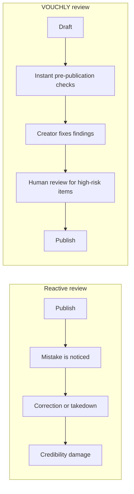
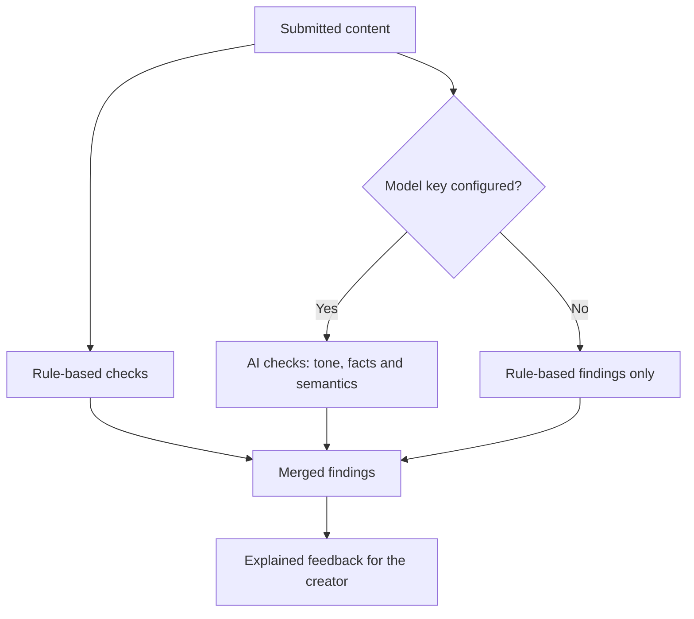
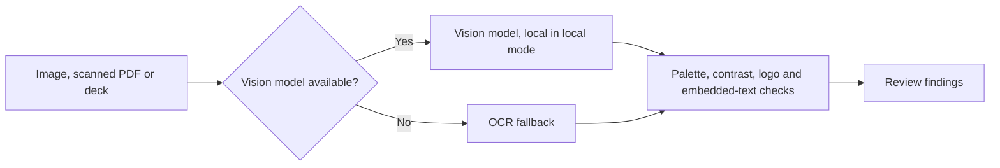
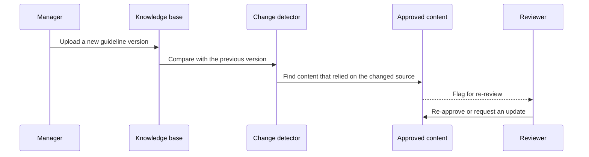
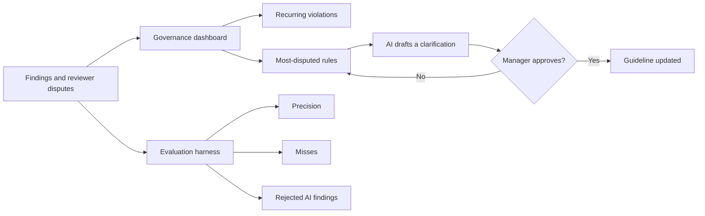
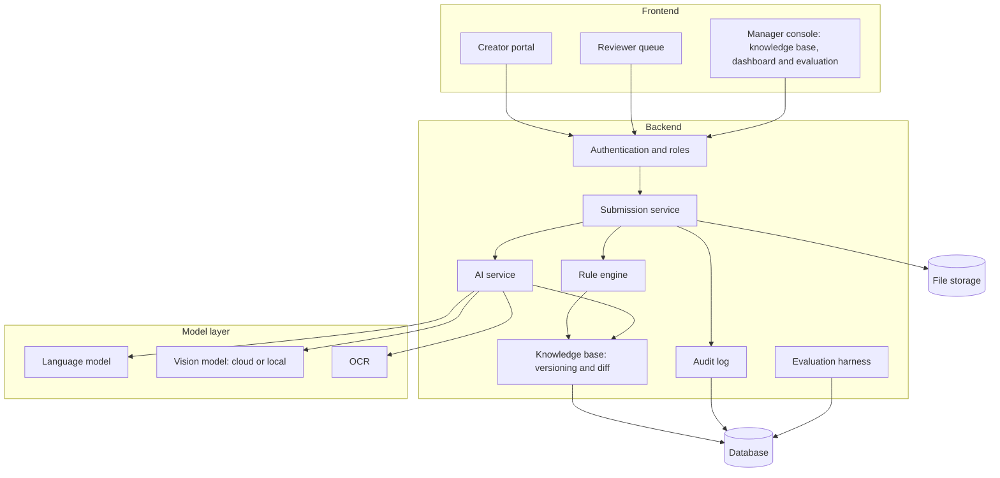
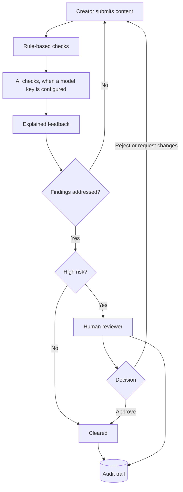
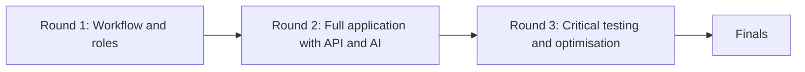

<div align="center">

# VOUCHLY

### Pre-publication brand governance with human oversight

Check content against your brand guidelines before it is published, with instant explained feedback, human accountability and a full audit trail.

[Problem](#the-problem) · [Solution](#the-solution) · [Features](#core-features) · [Improvements](#improvements) · [Architecture](#system-architecture) · [Workflow](#review-workflow) · [Roadmap](#event-roadmap) · [Impact](#expected-impact) · [Future Scope](#future-scope) · [Setup](#getting-started) · [Team](#team)

</div>

---

## The Problem

Brand guidelines are usually enforced after content has been published. An off-brand phrase, an unsupported claim or an inaccessible design is noticed only once it has reached an audience, and the organisation is left with a correction, a takedown or lasting damage to its credibility.

Catching mistakes late is only part of the problem. Guidelines are applied inconsistently, creators wait for vague feedback, reviewers lose time on routine issues, and approved content is never revisited when the guidance behind it changes.

| Pain point | Consequence |
|---|---|
| Reviews happen late and take time | Creators wait, then rework content close to publication |
| Feedback is vague or inconsistent | The same issues recur across teams and submissions |
| Reviewers spend time on routine issues | Less attention for content that needs judgement |
| Guidelines change but approved content is not revisited | Outdated claims stay in circulation |
| Brand rules are spread across employees, agencies and AI tools | Messaging becomes inconsistent across channels |

## The Solution

VOUCHLY moves brand review from reactive correction to proactive prevention. It checks content for tone, terminology, factual claims and accessibility before publication, and gives creators feedback that states what is wrong, why it matters and how to fix it.

Creators resolve routine issues themselves, instantly. Reviewers and managers concentrate on high-risk items. Every submission, finding and decision is recorded in an audit trail, and final accountability always stays with people.



> **Model key required for AI findings.** AI-generated findings need a configured model key. Without one, only the rule-based checks run. Rule-based checks never depend on the AI configuration.

---

## Core Features

| ID | Capability | Description |
|---|---|---|
| C1 | Tone and terminology | Flags language that departs from the brand voice, including banned and non-preferred wording |
| C2 | Factual and claim checks | Flags claims that are not supported by the approved sources available to the review |
| C3 | Accessibility checks | Built-in checks for accessible and inclusive content |
| C4 | Explained feedback | Every finding states the issue, why it matters and a suggested fix |
| C5 | Human in the loop | Reviewers confirm, reject or override findings, so accountability stays with people |
| C6 | Audit trail | Submissions, findings and decisions are logged for traceability and compliance |

### How findings are produced

Deterministic rule-based checks always run. When a model key is configured, AI checks run alongside them and the findings are merged.



| Mode | Requirement | Output |
|---|---|---|
| Rule-based | None | Findings from deterministic checks |
| AI-assisted | Model key | Rule-based findings plus AI-generated findings |
| Local | Local model | AI-assisted checks that run inside the organisation's own environment, so content stays in-house |

---

## Improvements

Three improvements extend VOUCHLY from text review into visual review, living guidelines and measured reliability. They form the Round 2 build scope.

| ID | Improvement | What it adds |
|---|---|---|
| I1 | Multimodal review | Reviews images, scanned PDFs and deck visuals |
| I2 | Living knowledge base | Versioned guidelines with change detection and re-review of affected content |
| I3 | Governance intelligence | Violation and dispute analytics, AI-drafted clarifications and a reliability evaluation harness |

### I1. Multimodal Review

**Objective:** let creators submit what they actually publish, not a text approximation of it.

**Supported inputs:** images, scanned PDFs and presentation deck visuals.

**Review process**

1. A vision model analyses the submitted visual. In local mode, a local vision model is used.
2. If a vision model is unavailable, OCR extracts the text as a fallback, so review always continues.
3. Visual and extracted-text information passes through the relevant checks.

**Checks added**

| Check | What it verifies |
|---|---|
| Palette | Colours match the approved brand palette |
| Contrast | Text and background combinations meet accessibility requirements |
| Logo | The logo is present and used according to brand rules |
| Embedded text | Text inside images follows tone, terminology and claim rules |



### I2. Living Knowledge Base

**Objective:** treat guidelines as maintained, versioned sources, so approved content does not silently go out of date.

**Capabilities**

- A manager page to upload guidelines and keep every version.
- Change detection between successive versions.
- Automatic flagging of content that relied on a source that has changed.
- Re-review of flagged content, so outdated claims are caught even after approval.



### I3. Governance Intelligence and Measured Reliability

**Objective:** use review outcomes to improve the guidelines themselves, and prove how reliable the AI findings are.

**Governance dashboard**

| Panel | Purpose |
|---|---|
| Recurring violations | Shows which rules are repeatedly broken and where creators need training |
| Most-disputed rules | Shows which rules are frequently challenged and may be unclear |
| AI-drafted clarifications | Proposes clearer wording for disputed rules. A manager must approve a clarification before any guideline changes |

**Evaluation harness**

| Metric | Meaning |
|---|---|
| Precision | Share of AI findings that were correct |
| Misses | Real issues the system failed to flag |
| Rejected AI findings | AI findings that reviewers overruled |

Reviewer overrides feed the harness directly, so reliability is measured from real decisions rather than assumed.



---

## System Architecture

The architecture separates role-based portals, application services, the model layer and storage.



| Layer | Responsibility |
|---|---|
| Frontend | Role-based interfaces for creators, reviewers and managers |
| Backend API | Submissions, rule execution, AI orchestration, knowledge-base versioning, audit logging and evaluation |
| Model layer | Language model, cloud or local vision model, and OCR fallback |
| Storage | Structured application data and uploaded files |

---

## Review Workflow

Creators address findings before content reaches a reviewer. Human review is reserved for items whose risk or nature requires a decision.



### Roles and responsibilities

| Role | Responsibilities |
|---|---|
| Creator | Submits content, acts on instant feedback and can dispute a finding |
| Reviewer | Handles escalated items, confirms or overrides findings and records a decision |
| Manager | Maintains and versions guidelines, approves AI-drafted clarifications and reads the governance dashboard |

---

## Event Roadmap

| Round | Focus | Status |
|---|---|---|
| Round 1 | Workflow design and team role decisions | Complete |
| Round 2 | Fully developed web application with complete API and AI integration, including all three improvements (I1 to I3) | In progress |
| Round 3 | Critical testing to expose flaws in the product, then restructuring for efficiency ahead of the finals | Upcoming |



---

## Expected Impact

VOUCHLY moves brand consistency from reactive correction to proactive prevention. By catching tone, terminology, factual and accessibility issues before publication, it reduces the public mistakes, takedowns and corrections that damage credibility.

| Stakeholder | Expected outcome |
|---|---|
| Organisation | Fewer public mistakes, takedowns and corrections; faster publishing cycles; more consistent messaging across employees, agencies and AI tools |
| Creators | Instant, explained feedback; less time waiting for reviews and less rework after rejection |
| Managers and reviewers | Freed from routine checks to focus on high-risk items, with a full audit trail that supports compliance |
| Brand guidelines | Recurring violations and frequently disputed rules show where guidelines need improving and where creators need training |
| Legal and compliance | Lower legal and regulatory risk from unsupported claims |
| Audiences | More inclusive content through built-in accessibility checks |

### How the impact is measured

The impact is not left as a claim. The platform records the data needed to verify it.

| Outcome | Evidence the platform produces |
|---|---|
| Reliable AI assistance | Precision, misses and rejected AI findings from the evaluation harness |
| Better guidelines | Recurring violations and most-disputed rules on the governance dashboard |
| Reduced rework and faster cycles | Submission, finding and decision history in the audit trail |
| Outdated content caught | Content flagged for re-review after a guideline version changes |

The human-in-the-loop design keeps accountability with people. Organisations can adopt AI assistance without losing control over their brand.

---

## Future Scope

| Horizon | Planned work |
|---|---|
| Near term | Integrations with Slack, Google Workspace, Microsoft 365, Figma and WordPress, so content is reviewed where it is created |
| Near term | Multilingual support and regional brand variants |
| Near term | Video and audio review, and deeper visual checks such as logo misuse |
| Next | Learning from approved and disputed decisions to improve checks for each organisation, with humans staying in control |
| Next | Flagging claims that become outdated when their source documents change |
| Enterprise | Single sign-on, on-premises deployment and compliance reporting |
| Long term | A public API so agencies and AI content generators can check content against the brand automatically, making brand-safe content the default |

---

## Getting Started

```bash
git clone https://github.com/MrTickstimely/VOUCHLY.git
cd VOUCHLY
```

**Model configuration.** Set your model key in the project's environment configuration to enable AI findings. With no key set, VOUCHLY runs rule-based checks only. To keep content inside your own environment, use local mode with a local model.

---

## Team

| Member | Role |
|---|---|
| Ekansh Gupta | Full Stack |
| Harsh Kumar | Backend |
| Aditya Vishwakarma | Backend |
| Aditi Sharma | Frontend |

---

<div align="center">

**VOUCHLY**

Brand-safe content, by default.

</div>

